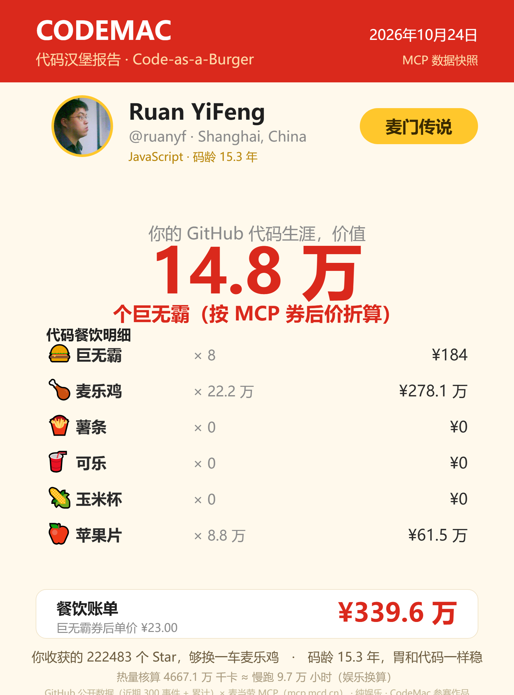

<div align="center">

# 🍔 CodeMac · 代码汉堡报告

**你的 GitHub 代码生涯，值多少个巨无霸？**

输入任意 GitHub 用户名，把 commit、Star、PR、Issue、Review、粉丝
换算成巨无霸、麦乐鸡、薯条、可乐、玉米杯和苹果片——
价格来自 **麦当劳中国官方 MCP（mcp.mcd.cn）实时数据**。

[](https://github.com/M-China/mcd-developer-innovation-challenge)
[](https://github.com/M-China/mcd-mcp-server)
[](LICENSE)
[](https://nodejs.org)

**⚡ [打开网站在线玩 → https://alvin2guo.github.io/codemac/](https://alvin2guo.github.io/codemac/)** ｜ 零配置，无需登录，无需 Token



</div>

---

## ✨ 这是什么

CodeMac 是一个基于 **麦当劳中国 MCP** 的创意 Skill：它读取你的 GitHub 公开数据，
用 MCP 的实时餐品价格给你算一笔「代码餐饮账单」，并生成一张可以晒朋友圈的分享卡片。

```
🍔 巨无霸   × 86      ← 你的 commit
🍗 麦乐鸡   × 1,204   ← 你收到的 Star
🍟 薯条     × 37      ← 你合并的 PR
🥤 可乐     × 52      ← 你提的 Issue
🌽 玉米杯   × 18      ← 你的 Code Review
🍎 苹果片   × 960     ← 你的粉丝

────────────────────────────
你的 GitHub 代码生涯，价值 108.6 个巨无霸
餐饮账单 ¥2,094.50（按 MCP 实时价格）
```

## 🎮 在线体验

**→ [https://alvin2guo.github.io/codemac/](https://alvin2guo.github.io/codemac/)**

输入任意 GitHub 用户名（试试 `torvalds`、`ruanyf`、`yyx990803`），
立即生成报告卡片，可下载 PNG / SVG。网页版使用预生成的 MCP 数据快照；
想用实时价格，请看下面的命令行模式。

## 🚀 快速开始

### 方式一：网页（零配置）

打开 [https://alvin2guo.github.io/codemac/](https://alvin2guo.github.io/codemac/)，输入 GitHub 用户名即可。

### 方式二：命令行（MCP 实时取价）

```bash
# 1. 克隆仓库（零第三方依赖，Node.js >= 18 即可运行）
git clone https://github.com/alvin2guo/codemac.git
cd codemac

# 2. 申请麦当劳 MCP Token：https://open.mcd.cn/mcp
#    （手机号登录 → 控制台 → 激活 → 一键复制）
export MCD_TOKEN=<你的 MCP Token>

# 3. 生成报告 + 分享卡片（SVG）
node src/cli.js torvalds --out my-card.svg

# 4. 只看文字报告 / JSON
node src/cli.js torvalds
node src/cli.js torvalds --json
```

可选参数：

| 参数 | 说明 |
|---|---|
| `--mcd-token <token>` | 直接传 MCP Token（也可用环境变量 `MCD_TOKEN`） |
| `--github-token <token>` | GitHub Token（也可用 `GITHUB_TOKEN`），提高 API 限流额度 |
| `--out <file>` | SVG 卡片输出路径，默认 `codemac-<用户名>.svg` |
| `--json` | 以 JSON 输出完整报告数据 |

### 方式三：本地演示站（实时模式）

```bash
MCD_TOKEN=<你的 MCP Token> node src/server.js
# 打开 http://localhost:8787/ ，网页自动切换为 MCP 实时取价
```

### 作为 WorkBuddy Skill 使用

把本仓库的 `SKILL.md` 与 `mcp-config.example.json` 接入你的智能体客户端
（WorkBuddy / Cherry Studio / Cursor / Trae 等），即可让 AI 直接调用：

> 「帮我看看 @torvalds 的代码值多少个巨无霸」

## 🧩 工作原理

```
GitHub 公开 API                麦当劳 MCP (mcp.mcd.cn)
  用户资料 / 事件流 / 仓库        now-time-info / query-meals
        │                        query-meal-detail / calculate-price
        ▼                        list-nutrition-foods / campaign-calendar
  ┌──────────────┐  JSON-RPC over Streamable HTTP  ┌──────────────┐
  │ 指标归一化    │ ◀──────────────────────────────▶ │  MCP 客户端   │
  └──────┬───────┘                                   └──────┬───────┘
         │                                                   │
         ▼                                                   ▼
  ┌─────────────────────────────────────────────────────────────┐
  │  computeReport()  代码指标 × 实时餐品价格 = 巨无霸等价比        │
  │  renderCardSvg()  SVG 分享卡片 ｜ 网页 Canvas → PNG           │
  └─────────────────────────────────────────────────────────────┘
```

数据来源三级降级：`live`（MCP 实时）→ `snapshot`（预生成快照）→ `fallback`（内置参考价），
任何环境下演示站都能打开即用。详见 [MCP_INTEGRATION.md](MCP_INTEGRATION.md)。

## 📁 项目结构

```
codemac/
├── index.html               # 在线演示页（GitHub Pages，Canvas 渲染卡片）
├── src/
│   ├── cli.js               # 命令行入口
│   ├── mcp.js               # 零依赖麦当劳 MCP 客户端（Streamable HTTP + JSON-RPC）
│   ├── github.js            # GitHub 公开数据抓取与指标归一化
│   ├── menu-data.js         # 菜单数据解析（实时 / 快照 / 兜底）
│   ├── report.js            # 代码指标 → 餐品换算与计价
│   ├── card.js              # SVG 分享卡片渲染
│   └── server.js            # 本地演示站 + MCP 代理
├── scripts/snapshot.js      # 预生成 MCP 数据快照
├── data/mcd-snapshot.json   # 由真实 MCP 调用生成的快照
├── docs/mcp-raw/            # MCP 各工具原始返回存档
├── MCP_INTEGRATION.md       # MCP 集成说明
└── SKILL.md                 # WorkBuddy Skill 定义
```

## 🎖️ 参赛信息

本项目参加 **麦当劳程序员创意开发大赛**（1024 程序员节），
基于麦当劳中国 MCP 开发，使用腾讯 WorkBuddy 完成从需求到上线的全流程。

- 赛事主页：<https://github.com/M-China/mcd-developer-innovation-challenge>
- 麦当劳 MCP 文档：<https://github.com/M-China/mcd-mcp-server>

## ⚠️ 免责声明

- 本项目为娱乐向作品，非麦当劳官方产品，与麦当劳公司无隶属关系；
- commit / PR / Issue / Review 按最近 300 个公开事件统计，Star / 粉丝为累计值；
- 餐品价格、活动信息以麦当劳官方渠道实时结果为准；
- 报告结果纯属娱乐换算，不构成营养、健康或投资建议。

## 📄 License

[MIT](LICENSE)
